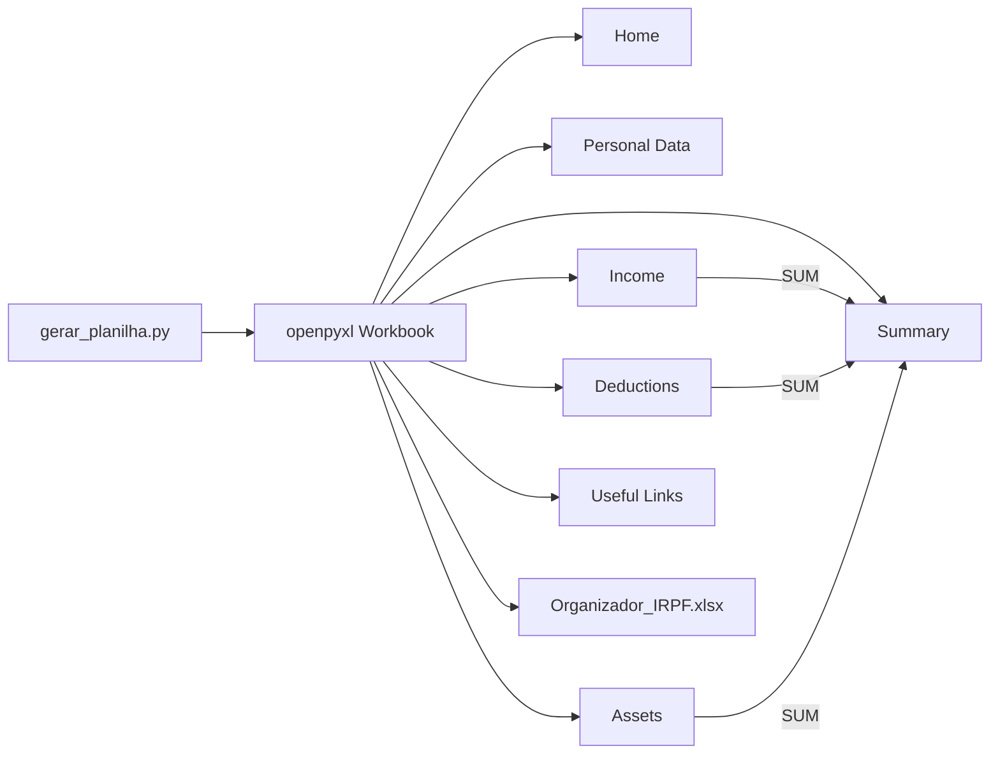

# organizador-imposto-de-renda

**English** · [Português (Brasil)](README.md)

  

## What it is

A data aggregator for the Brazilian income tax return, built as an Excel workbook generated by a script. A single Python script (`gerar_planilha.py`) builds `Organizador_IRPF.xlsx` with seven tabs linked by a navigation bar, validation lists and a summary consolidated by native Excel formulas.

## Status

Working. The generator runs end to end with `openpyxl` and produces the workbook with all seven tabs. There are no automated tests.

## Features

- **Seven tabs**: Home, Personal Data, Income, Deductions, Assets and Rights, Summary and Useful Links.
- **Navigation bar**: merged cells in rows 1–2 of every tab with a hyperlink to `#'Tab'!A1`; the current tab is highlighted.
- **List validation**: income type (5 options), deduction category (7) and asset group (6), applied through `DataValidation`.
- **Automatic totals**: `=SUM(...)` on Income (40 rows), Deductions (30) and Assets (25).
- **Conditional formatting**: income values above R$ 10,000 are highlighted.
- **Consolidated summary**: formulas that pull the three totals, compute the base (income − deductions) and an estimated tax.
- **Useful links**: shortcuts to the Brazilian Federal Revenue, e-CAC, refund lookup and DIO challenge material.
- **Visual theme**: black, white and grey, with gridlines off and frozen headers.

## Architecture

The script is linear: it defines the palette, styles and helpers, then creates each tab in order and saves the `.xlsx`. Four helpers carry the repetition:

- `barra_navegacao(ws, ncols)` — splits the width into seven buttons and links each one to its tab.
- `titulo(ws, texto, ncols, linha)` — merged title band.
- `cabecalho(ws, linha, valores)` — table header.
- `linha_campo(ws, r, label, valor, zebra, ph)` — label/value pair with zebra striping.



## Stack

- Python 3
- `openpyxl` (styles, data validation, conditional formatting, hyperlinks)
- Excel / LibreOffice to open the generated file

## Repository structure

```
organizador-imposto-de-renda/
├── gerar_planilha.py          # full workbook generator
├── Organizador_IRPF.xlsx      # generated output (committed)
├── contexto do desafio.txt    # DIO challenge statement
├── README.md                  # Portuguese version
└── README.en.md               # this file
```

## Prerequisites and installation

Python 3 and `openpyxl`:

```bash
pip install openpyxl
```

There is no `requirements.txt`; `openpyxl` is the only external dependency.

## How to run

```bash
python gerar_planilha.py
```

The script writes `Organizador_IRPF.xlsx` to the current directory and prints the list of created tabs. Then open the file in Excel or LibreOffice and fill the tabs in the order suggested by the Home tab.

## Tests and quality

There are no automated tests. Verification consisted of running the generator from scratch (Python 3, `openpyxl` 3.1.5): the file is created without errors and contains the seven expected tabs. The `.pytest_cache` folder in the repository is leftover, not evidence of a test suite.

## Technical decisions and trade-offs

- **Excel as the interface, Python only as the generator**: end users do not need Python to use the workbook; in exchange, layout changes require running the script again.
- **Plain `.xlsx`, no VBA**: opens without a macro warning and works in LibreOffice; in exchange, the "buttons" are cell hyperlinks, not form controls.
- **Native formulas instead of values computed in Python**: the workbook recalculates as the user edits; in exchange, reading the file with `openpyxl` in `data_only` mode outside Excel returns `None` for formula cells.
- **Validation lists as strings in code**: simple, no helper sheet; in exchange, adding a category means editing code and regenerating the file.
- **Fixed 15% rate in the summary**: keeps the workbook generic and educational, but does not reproduce the progressive tax table.

## Known limitations and roadmap

- The estimated tax uses a flat 15% rate and is illustrative only; it does not replace the official Revenue program or an accountant.
- Categories, income types and asset groups are hardcoded.
- No `LICENSE` file in the repository, despite the MIT reference.
- No automated tests.
- Roadmap: move the lists into a parameters sheet, apply the real progressive table and add tests with `openpyxl`.

## Development process

An individual project by Kelvin Oliveira for a DIO challenge, built with AI agents and reviewed by the author. The code and the workbook layout were written from the statement in `contexto do desafio.txt`.

## License and author

MIT (the `LICENSE` file is not included in this repository).

**Author**: [Kelvin Oliveira](https://github.com/KelvinOliveiraCode) · [Portfolio](https://kelvinoliveiracode.github.io/portfolio/)
