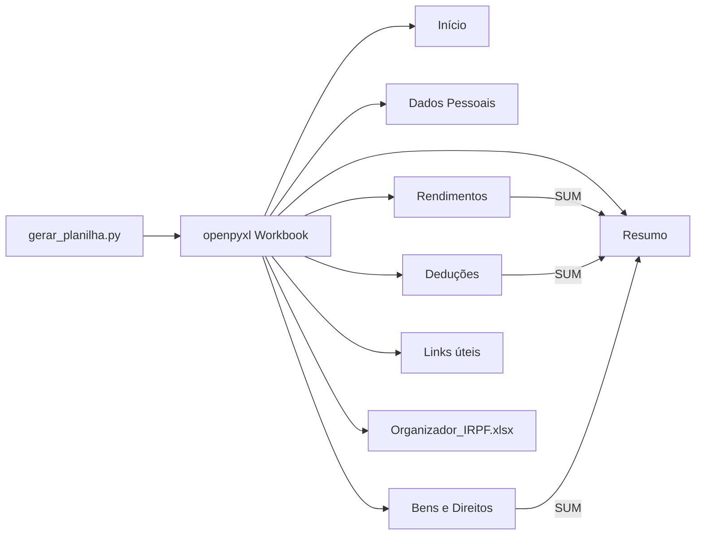

# organizador-imposto-de-renda

[English](README.en.md) · **Português (Brasil)**

  

## O que é

Agregador de dados para a declaração de Imposto de Renda em uma planilha Excel gerada por script. Um único script Python (`gerar_planilha.py`) monta o arquivo `Organizador_IRPF.xlsx` com sete abas ligadas por uma barra de navegação, listas de validação e um resumo consolidado por fórmulas nativas do Excel.

## Status

Funcional. O gerador roda de ponta a ponta com `openpyxl` e produz o arquivo com as sete abas. Não há testes automatizados.

## Funcionalidades

- **Sete abas**: Início, Dados Pessoais, Rendimentos, Deduções, Bens e Direitos, Resumo e Links úteis.
- **Barra de navegação**: células mescladas nas linhas 1–2 de cada aba com hyperlink para `#'Aba'!A1`; a aba atual aparece destacada.
- **Validação em lista**: tipo de rendimento (5 opções), categoria de dedução (7) e grupo de bem (6), aplicadas por `DataValidation`.
- **Totais automáticos**: `=SUM(...)` em Rendimentos (40 linhas), Deduções (30) e Bens e Direitos (25).
- **Formatação condicional**: valores de rendimento acima de R$ 10.000 ganham destaque.
- **Resumo consolidado**: fórmulas que puxam os três totais, calculam a base (rendimentos − deduções) e um imposto estimado.
- **Links úteis**: atalhos para Receita Federal, e-CAC, restituição e materiais do desafio DIO.
- **Tema visual**: preto, branco e cinza, com gridlines desligadas e cabeçalhos congelados.

## Arquitetura

O script é linear: define paleta, estilos e helpers, cria cada aba em sequência e salva o `.xlsx`. Quatro helpers concentram a repetição:

- `barra_navegacao(ws, ncols)` — divide a largura em sete botões e liga cada um à aba correspondente.
- `titulo(ws, texto, ncols, linha)` — faixa de título mesclada.
- `cabecalho(ws, linha, valores)` — cabeçalho de tabela.
- `linha_campo(ws, r, label, valor, zebra, ph)` — par rótulo/valor com efeito zebrado.



## Stack

- Python 3
- `openpyxl` (estilos, validação de dados, formatação condicional, hyperlinks)
- Excel / LibreOffice para abrir o arquivo gerado

## Estrutura do repositório

```
organizador-imposto-de-renda/
├── gerar_planilha.py          # gerador completo da planilha
├── Organizador_IRPF.xlsx      # saída gerada (versionada)
├── contexto do desafio.txt    # enunciado do desafio DIO
├── README.md                  # este arquivo
└── README.en.md               # versão em inglês
```

## Pré-requisitos e instalação

Python 3 e `openpyxl`:

```bash
pip install openpyxl
```

Não há `requirements.txt`; a única dependência externa é `openpyxl`.

## Como executar

```bash
python gerar_planilha.py
```

O script grava `Organizador_IRPF.xlsx` no diretório atual e imprime a lista de abas criadas. Depois, abra o arquivo no Excel ou LibreOffice e preencha as abas na ordem sugerida pela aba Início.

## Testes e qualidade

Não há testes automatizados. A verificação feita foi executar o gerador do zero (Python 3, `openpyxl` 3.1.5): o arquivo é criado sem erro e contém as sete abas esperadas. A pasta `.pytest_cache` no repositório é resíduo, não indica suíte de testes.

## Decisões técnicas e trade-offs

- **Excel como interface, Python só como gerador**: o usuário final não precisa de Python para usar a planilha; em troca, mudanças de layout exigem rodar o script de novo.
- **`.xlsx` puro, sem VBA**: abre sem aviso de macro e funciona no LibreOffice; em troca, os "botões" são hyperlinks de célula, não controles de formulário.
- **Fórmulas nativas em vez de valores calculados no Python**: a planilha recalcula quando o usuário edita; em troca, ler o arquivo com `openpyxl` em modo `data_only` fora do Excel retorna `None` para células de fórmula.
- **Listas de validação como string no código**: simples e sem aba auxiliar; em troca, incluir uma categoria nova é edição de código e nova geração.
- **Alíquota fixa de 15% no resumo**: mantém a planilha genérica e didática, mas não reproduz a tabela progressiva.

## Limitações conhecidas e roadmap

- O imposto estimado usa alíquota fixa de 15% e é apenas ilustrativo; não substitui o programa da Receita nem um contador.
- Categorias, tipos e grupos são fixos no código.
- Sem arquivo `LICENSE` no repositório, apesar da referência a MIT.
- Sem testes automatizados.
- Roadmap: mover as listas para uma aba de parâmetros, aplicar as faixas reais da tabela progressiva e adicionar testes com `openpyxl`.

## Processo de desenvolvimento

Projeto individual de Kelvin Oliveira para um desafio da DIO, construído com apoio de agentes de IA e revisado pelo autor. O código e o layout da planilha foram escritos a partir do enunciado em `contexto do desafio.txt`.

## Licença e autor

MIT (o arquivo `LICENSE` não está incluído neste repositório).

**Autor**: [Kelvin Oliveira](https://github.com/KelvinOliveiraCode) · [Portfólio](https://kelvinoliveiracode.github.io/portfolio/)
